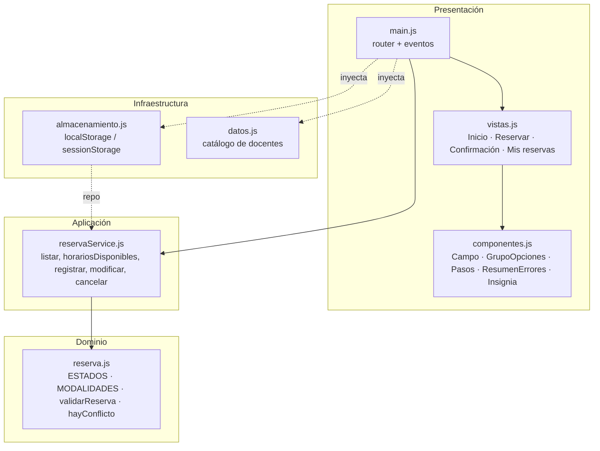

# Arquitectura de software

Arquitectura en 4 capas con dependencias hacia adentro (presentación → aplicación → dominio; infraestructura se inyecta en aplicación).

## Responsabilidades
| Capa | Archivo | Responsabilidad | No hace |
|---|---|---|---|
| Presentación | `presentation/*`, `main.js` | Dibujar pantallas, capturar eventos, manejar foco y rutas | Reglas de negocio |
| Aplicación | `application/reservaService.js` | Casos de uso R1–R6 | Acceso al DOM |
| Dominio | `domain/reserva.js` | Validaciones, estados, conflicto de horario | Almacenamiento ni DOM |
| Infraestructura | `infrastructure/*` | Persistir y proveer datos | Validar |

## Decisiones
- **Inyección de dependencias**: `crearReservaService({ repo, docentes, ahora })` permite probar el servicio con un repositorio en memoria y una fecha fija (ver `tests/`), y cambiar `localStorage` por una API sin tocar otras capas.
- **Borrador en `sessionStorage`**: cada cambio se guarda al instante, así al volver atrás, recargar o corregir un error no se pierde lo elegido.
- **Sin framework ni build**: HTML, CSS y JS con módulos ES; se ejecuta con cualquier servidor estático.
- **Componentes reutilizables**: `Campo` y `GrupoOpciones` aplican de forma uniforme etiquetas, ayudas, errores y atributos ARIA.
