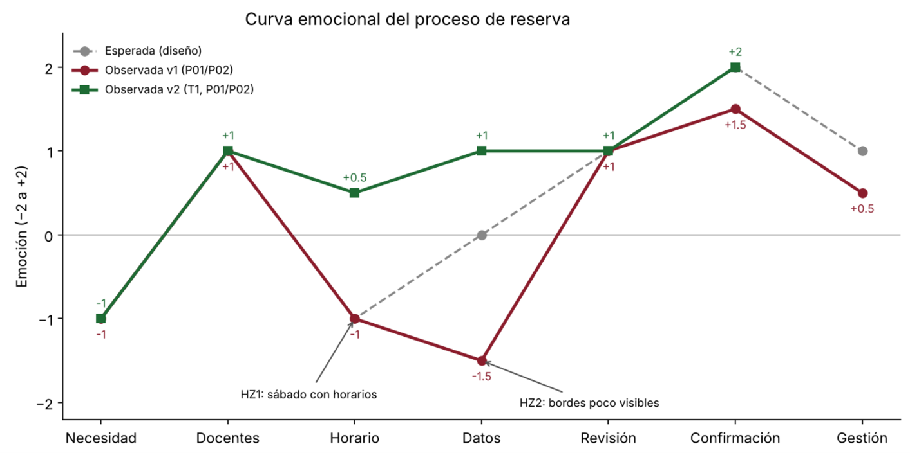

# Curva emocional del proceso de reserva

Escala: −2 (muy negativo) a +2 (muy positivo). Se compara la curva esperada en el diseño con la observada en la v1 y en la v2.

| Etapa | Touchpoint | Emoción esperada | Esperado | Observado v1 (P01 / P02 → prom.) | Observado v2, T1 (P01 / P02 → prom.) |
|---|---|---|---|---|---|
| 1. Necesita tutoría | — | Preocupación por la prueba | −1 | −1 / −1 → **−1** | −1 / −1 → **−1** |
| 2. Consulta docentes | T1 | Alivio al encontrar al docente | +1 | +1 / +1 → **+1** | +1 / +1 → **+1** |
| 3. Elige fecha y horario | T2 | Incertidumbre (momento crítico 1) | −1 | −2 / 0 → **−1** · P01 eligió sábado y vio horarios (HZ1) | 0 / +1 → **+0.5** · aviso inmediato |
| 4. Llena sus datos | T3 | Neutral; frustración si hay error | 0 | −1 / −2 → **−1.5** · correo y bordes poco visibles (HZ2) | +1 / +1 → **+1** |
| 5. Revisa y confirma | T4 | Seguridad | +1 | +1 / +1 → **+1** | +1 / +1 → **+1** |
| 6. Recibe confirmación | T4 | Satisfacción | +2 | +2 / +1 → **+1.5** | +2 / +2 → **+2** |
| 7. Modifica o cancela | T5 | Control | +1 | 0 / +1 → **+0.5** · duda al modificar (HZ3) | no reevaluado |

> Valores observados: datos, coherentes con [metricas.md](../evaluacion/metricas.md). En la v2 solo se repitió T1 (etapas 1–6).

**Lectura:** en la v1 los puntos bajos (etapas 3 y 4) coinciden con los dos momentos críticos del análisis UX y con HZ1 y HZ2; la etapa 4 quedó incluso por debajo de lo esperado (−1.5 frente a 0). En la v2, tras corregir esos dos problemas, las etapas 3 y 4 suben a +0.5 y +1 y la curva ya no tiene caídas antes de la confirmación. La etapa 7 sigue por debajo de lo esperado por HZ3, que quedó en el backlog.
