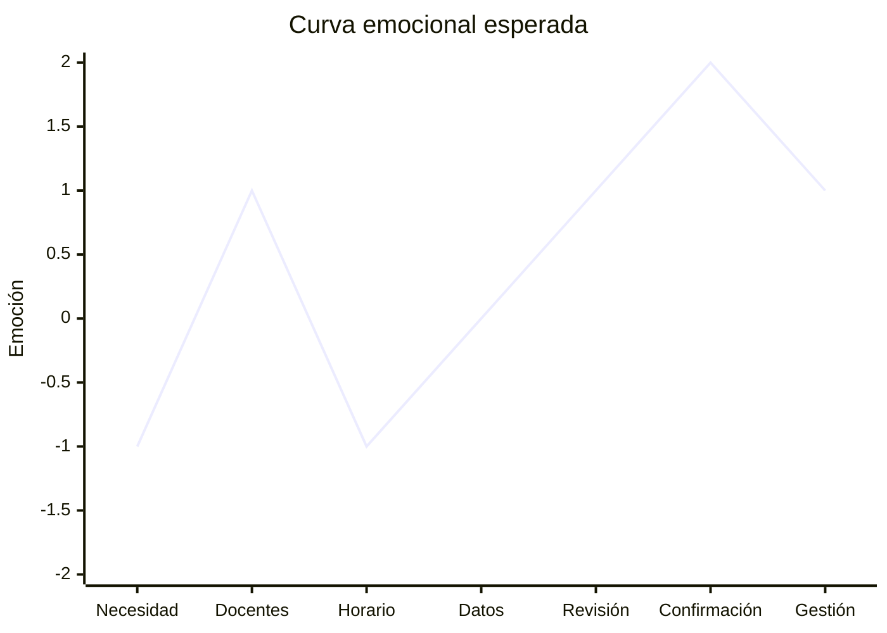

# Curva emocional del proceso de reserva

Escala: −2 (muy negativo) a +2 (muy positivo). Valores esperados en el diseño; actualizar con lo observado en P01/P02.

| Etapa | Touchpoint | Emoción | Valor v1 (esperado) | Valor observado P01/P02 |
|---|---|---|---|---|
| 1. Necesita tutoría | — | Preocupación por la prueba | −1 | |
| 2. Consulta docentes | T1 | Curiosidad / alivio al encontrar al docente | +1 | |
| 3. Elige fecha y horario | T2 | Incertidumbre (momento crítico 1) | −1 | |
| 4. Llena sus datos | T3 | Neutral; frustración si hay error | 0 / −2 | |
| 5. Revisa y confirma | T4 | Seguridad | +1 | |
| 6. Recibe confirmación | T4 | Satisfacción | +2 | |
| 7. Modifica o cancela | T5 | Control | +1 | |

**Puntos bajos** (etapas 3 y 4) coinciden con los momentos críticos; ahí se concentran las mejoras de diseño y las tareas de evaluación T1 y T2.
