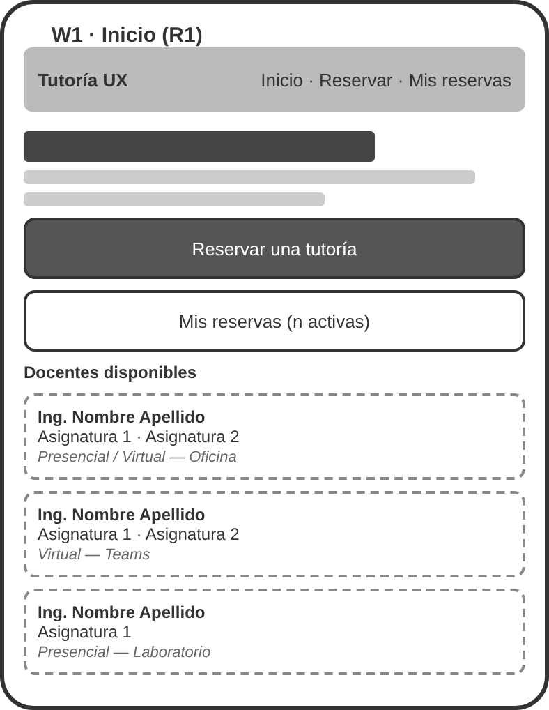
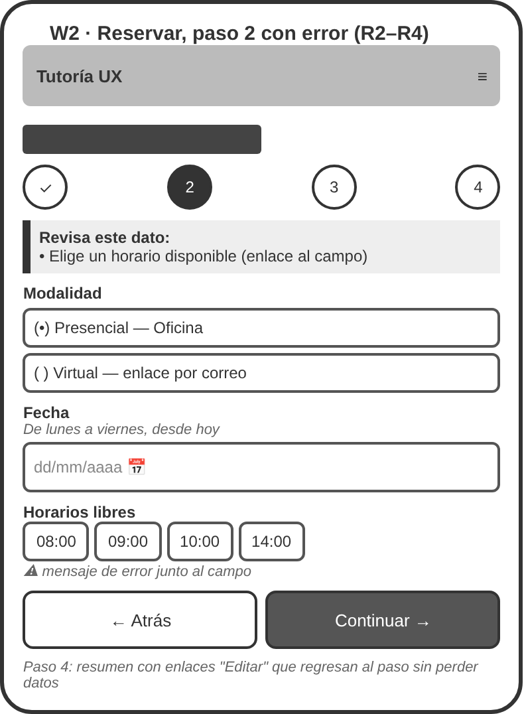
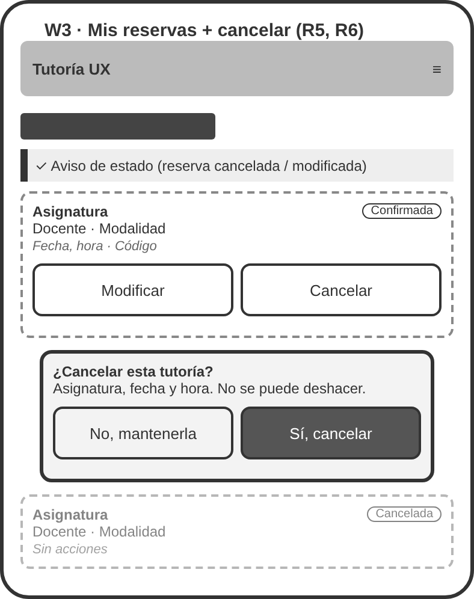

# Wireframes (baja fidelidad, móvil)

| W1 Inicio | W2 Reservar (paso 2 con error) | W3 Mis reservas |
|---|---|---|
|  |  |  |

Abajo, la versión en texto de cada wireframe.

## W1 — Inicio (R1)
```
┌──────────────────────────┐
│ Tutoría UX     [≡ menú]  │
├──────────────────────────┤
│ Reserva tu tutoría       │
│ Elige en 4 pasos…        │
│ [ Reservar una tutoría ] │
│ [ Mis reservas (n) ]     │
│ Docentes disponibles     │
│ ┌──────────────────────┐ │
│ │ Ing. Nombre          │ │
│ │ Asignatura · Asig.   │ │
│ │ Presencial / Virtual │ │
│ └──────────────────────┘ │
└──────────────────────────┘
```

## W2 — Reservar (R2, R3, R4)
```
┌──────────────────────────┐
│ Nueva reserva            │
│ (1)─(2)─(3)─(4)  progreso│
│ ┌ Revisa este dato: ───┐ │  ← solo si hay error
│ │ • mensaje (enlace)   │ │
│ └──────────────────────┘ │
│ Modalidad  (•) Presenc.  │
│            ( ) Virtual   │
│ Fecha      [dd/mm/aaaa]  │
│ Horarios   [08:00][09:00]│
│ [ ← Atrás ][Continuar →] │
└──────────────────────────┘
```

## W3 — Mis reservas (R5, R6)
```
┌──────────────────────────┐
│ Mis reservas             │
│ ┌──────────────────────┐ │
│ │ Asignatura [Confirm.]│ │
│ │ Docente · Modalidad  │ │
│ │ Fecha, hora · Código │ │
│ │ [Modificar][Cancelar]│ │
│ └──────────────────────┘ │
│  ┌ ¿Cancelar tutoría? ┐  │  ← diálogo
│  │ [No] [Sí, cancelar]│  │
└──────────────────────────┘
```
